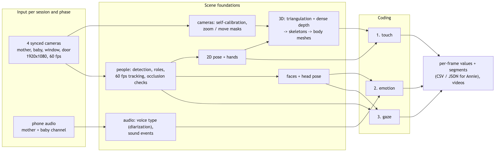
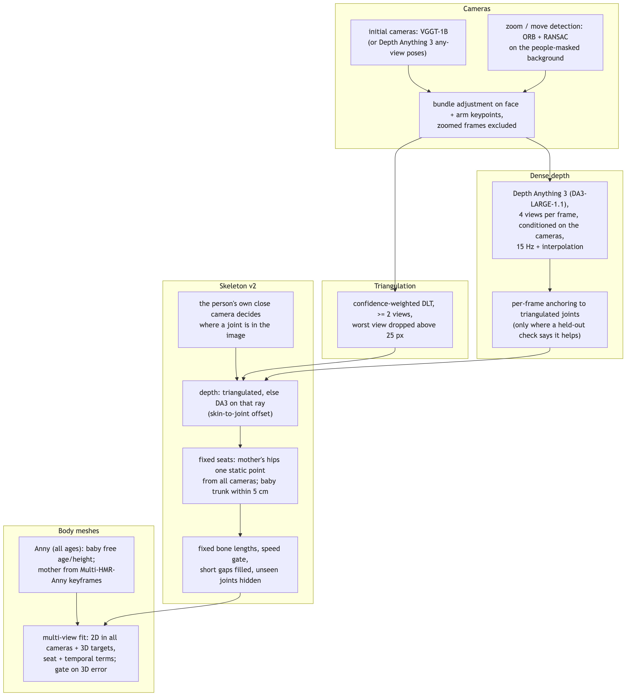
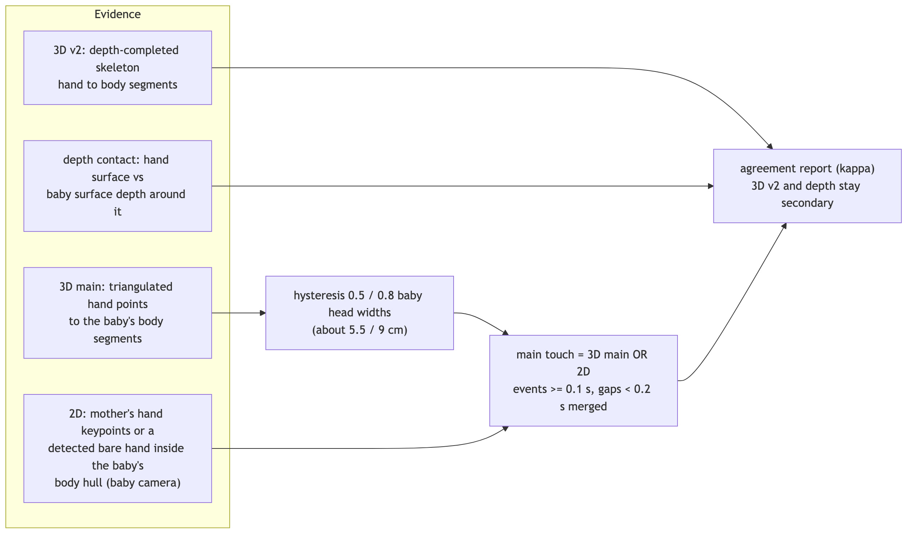
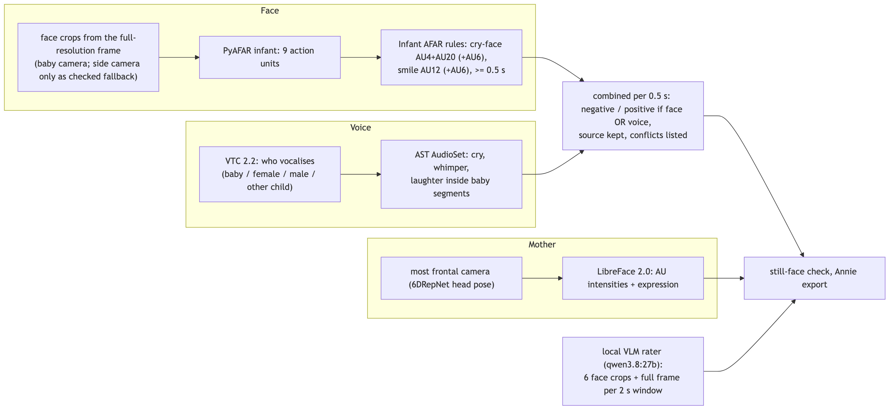
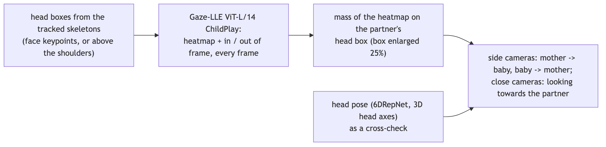
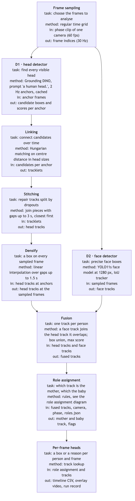
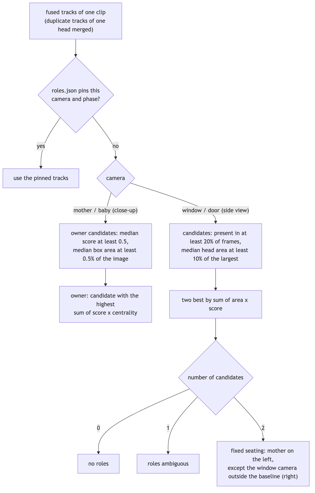

<!--
Kept near-identical to README.md minus GitHub-specific chrome (badges).
Update both in the same change.
-->

# StillFace

StillFace is a toolkit for the analysis of mother-baby interaction recorded with the **Still Face
paradigm**. A session consists of several synchronized camera views, heart rate variability
recordings and annotations, and is divided into the *baseline*, *play*, *stillface* and *reunion*
phases. The package prepares the raw recordings and provides the building blocks for extracting
behavioral features such as touch, affect and gaze between mother and baby.

## Features

| Stage | Functionality | Status |
|---|---|---|
| Data preparation | Camera synchronization (audio cross-correlation, via [avst](https://pypi.org/project/avst/)) | available |
| Data preparation | Phase cutting, stacked overview videos, session thumbnails | available |
| Data preparation | Metadata checks (missing recordings) | available |
| Feature extraction | Touch, affect, gaze | planned |
| Visualization | Overlays and export to [Annie](https://github.com/fodorad/Annie) | planned |

## Data layout

The original recordings are never modified. The `data/` folder of a checkout holds two soft links:

```text
data/
├── DB            -> <original dataset>/ELTE-PPK_StillFace      (read-only)
└── DB_PROCESSED  -> <processed dataset>/ELTE-PPK_StillFace     (generated)
```

All generated files are written below `DB_PROCESSED`:

```text
Sessions/<id>/normalized/   sources converted to mp4 at 60 fps
Sessions/<id>/synced/       time-aligned camera videos
Sessions/<id>/cut/          per-phase clips
Sessions/<id>/visualize/    stacked overview videos
Sessions/<id>/thumbnail.png
Thumbnails/                 one thumbnail per session
logs/                       synced / failed session bookkeeping
```

The locations can be overridden with the `STILLFACE_RAW_DIR` and `STILLFACE_PROCESSED_DIR`
environment variables or the `--raw-dir` / `--processed-dir` options.

## Dataset statistics

Computed from `metadata_database.xlsx` and the processed phase clips (`Sessions/<id>/processed/`),
which are the only video inputs of the analysis. All processed clips are 1920x1080 at 60 fps.

- **Sessions:** 78 recorded, 70 marked for analysis (`Analysis = y`).
- **Setup versions (analysed):** v4: 57, v3: 5, v2: 8.
- **Excluded from analysis:** 646022 (v4), 566015 (v4), 635928 (v2), 555623 (v2), 656417 (v2), 747417 (v1), 606117 (v1), 697115 (v1).

**Camera availability** (analysed sessions; a camera counts if it has at least one processed phase clip):

| Cameras | Sessions | Session ids |
|---|---|---|
| mother + baby + window + door | 49 | all other analysed sessions |
| mother + baby + window | 14 | 124731, 210118, 595525, 606021, 615027, 616018, 626527, 635916, 636211, 674821, 686912, 696807, 888726, 920320 |
| mother + baby | 3 | 114754, 656531, 717115 |
| baby + window | 2 | 585803, 595514 |
| baby + window + door | 1 | 717729 |
| mother + baby + door | 1 | 726030 |

**Incomplete phase sets** (camera present but fewer than 4 phase clips): 706922 window (3/4), 596613 window (3/4), 596613 door (3/4), 596025 baby (3/4), 646012 door (2/4), 505629 baby (1/4), 585803 baby (3/4), 114754 mother (3/4), 114754 baby (3/4).

**Native camcorder frame rate** (from the original camcorder files, where available; processed clips are all 60 fps):

| Camera | 50 fps progressive | 25 fps interlaced |
|---|---|---|
| window | 50 | 15: 525222, 555820, 575716, 594801, 595813, 596613, 616205, 646302, 657006, 666921, 686527, 696707, 697426, 717729, 757314 |
| door | 33 | 18: 484603, 535124, 586228, 596426, 605317, 616022, 616211, 625527, 625710, 636023, 646012, 656024, 656520, 666712, 674703, 677022, 736920, 819104 |

The phone cameras (mother, baby) record at about 60 fps with a variable frame rate.

**Play-phase clip lengths** differ between the cameras of a session by a median of 9 frames; larger differences (frames): 606021 (32), 595514 (46), 706922 (53), 646721 (154).

**Probing set** (play phase, setup v4) used to choose the analysis tools:

| Session | Cameras | Case |
|---|---|---|
| 605317 | mother, baby, window, door | dev, door 25i |
| 626021 | mother, baby, window, door | dev |
| 819104 | mother, baby, window, door | dev, door 25i |
| 594801 | mother, baby, window, door | window 25i, door occlusion |
| 636211 | mother, baby, window | no door camera |
| 656531 | mother, baby | close cameras only |

## Analysis stack

The coding of a session (touch, emotion, gaze) rests on a shared analysis of the scene: who is where, in which camera,
in 3D, and what is heard. All models are pretrained; nothing is trained on this dataset. The stack was built in three
probing rounds on the probing set above plus two more sessions (616106, the clearest four-camera session of a screen of
all 48, and 665814, the session with the most crying in play). Quality is measured without labels (reprojection,
temporal stability, agreement between independent methods, the still-face effect) and by visual review; human labels
(Annie) come next. Outputs are stored under `DB_PROCESSED/ELTE-PPK_StillFace/probes/`.



### Scene foundations



| Task | Selected | Tried and rejected (why) |
|---|---|---|
| Persons (2 Hz anchors) | Grounding DINO base ("a baby.", "a person.") + YOLOX-x persons | OWLv2 heads (missed back-of-head views) |
| Roles | seating rules per camera, side-camera baby boxes > 20% of the image ignored, session-level baby check | – |
| Tracking (60 fps) | skeleton-box tracking between anchors; duplicate-skeleton rejection; partner check (head >= 0.7x the owner's: rejects a doll) | – |
| 2D pose | RTMW-x whole body (133 keypoints), RGB input; visibility = SimCC score >= 3.0 (not a probability) | FiDIP infant pose (not better), ViTPose++-H (slower, similar) |
| Hands | RTMPose-m hand model on wrist-anchored boxes; ownership: hand wrist within 0.5 hand sizes of the body wrist; bare mother hands in the baby camera from Grounding DINO "a hand." | RTMDet-nano hand detector (fires on shoulders) |
| Faces | YOLO11s face detector, matched to the role head boxes, every frame | – |
| Head pose | 6DRepNet on every face crop; for the baby also model-free 3D head axes from the nose, eyes and ears | PyAFAR / LibreFace head pose (pitch medians -40 / -61 deg, roll nearly constant: unusable) |
| Cameras | self-calibration: VGGT-1B initial cameras, bundle adjustment on face and arm keypoints | radial distortion, multi-frame VGGT, initialising from another session (45-200 px) |
| Camera changes | zoom / move detection: ORB features on the people-masked background, RANSAC similarity against the calibration frame | phase correlation (fails on the plain walls) |
| Triangulation | confidence-weighted DLT, >= 2 views, worst view dropped above 25 px | – |
| Dense depth | Depth Anything 3 (DA3-LARGE-1.1, Apache-2.0): the 4 views of a frame in one pass, conditioned on the calibrated cameras; 15 Hz + interpolation | RTMW3D-x monocular lifting (jitter 5-20x the triangulated joints, outliers up to 129 head widths per frame) |
| Skeletons | the person's own close camera decides the image position; depth from triangulation or from DA3 on that ray; fixed seats, fixed bone lengths, speed gate; mother without legs | fusion v1 (triangulated + lifted joints) |
| Body meshes | Anny (NAVER, all ages): baby with free age and height; mother initialised from Multi-HMR-Anny keyframes; fitted to the skeletons and to the 2D keypoints of every camera | v1 per-frame fit (2-6% of frames flew off) |
| Voice type (diarization) | VTC 2.2: baby, female, male, other child; overlaps kept | – |
| Sound events | AST AudioSet (cry, sobbing, whimper, laughter, babbling) on 2 s windows | CLAP zero-shot (labels most fussing "coo") |
| Open-vocabulary grounding | Grounding DINO for persons and bare hands | – |
| VLM raters | qwen3.8:27b (local): 6 face crops + the full frame per 2 s window | gemma4:26b, gemma4:e4b with audio, Qwen3-VL-8B (see Emotion) |

**3D in numbers.** The window camcorder zooms at the start of play in 3 of 4 sessions (626021: 0-15 s, 636211: 0-29 s,
616106: 0-19 s; image scale 0.57-0.83 of the calibration frame). The calibration was wrong for those frames, and so
was every 3D point that used the window view there; this was a main cause of the jumpy 3D of round 2. Excluding those
frames and refitting improved every calibration (636211 baby camera 62 -> 12 px median; 626021 inliers 75 -> 82%).

Coverage / 99th percentile of the frame-to-frame step (baby head widths, about 11 cm), skeleton v2 vs fusion v1:

| Session | Mother arms | Mother hands | Baby arms | Baby legs | Baby feet |
|---|---|---|---|---|---|
| 626021 | 0.86 / 0.29 (0.84 / 1.22) | 0.38 / 0.50 (0.33 / 1.38) | 0.97 / 0.20 (0.79 / 0.30) | 0.75 / 0.33 (0.37 / 0.58) | 0.56 / 0.54 (0.55 / 2.16) |
| 636211 | 0.84 / 0.53 (0.54 / 2.39) | 0.27 / 0.26 (0.30 / 4.20) | 0.98 / 0.30 (0.82 / 0.83) | 0.56 / 0.31 (0.32 / 0.99) | 0.38 / 0.37 (0.37 / 3.59) |
| 616106 | 0.97 / 0.23 (0.75 / 1.21) | 0.32 / 0.31 (0.28 / 2.28) | 1.00 / 0.13 (0.52 / 55.0) | 0.77 / 0.37 (0.27 / 6.02) | 0.29 / 0.45 (0.20 / 84.4) |
| 665814 | 0.99 / 0.29 (0.81 / 0.73) | 0.35 / 0.32 (0.30 / 0.89) | 0.93 / 0.16 (0.64 / 0.28) | 0.37 / 0.25 (0.14 / 0.61) | 0.47 / 0.31 (0.28 / 1.27) |

DA3 depth against triangulated joints held out of the anchoring (arms): median 0.19-0.39 head widths (2-4 cm) with
per-frame anchoring, 0.33-0.46 with one global scale per camera. Body meshes are drawn on 97-100% of the frames (636211 mother: 52%, nothing during the window zoom)
(baby 2D error in the baby camera 5-15 px); the mother's side-camera error matches round 2 (626021: 26 / 24 px) at a
much steadier pose.

**Decisions made on the fly**
- Depth at 15 Hz instead of 60 fps: 60 fps would take more than 2 h per session on the Mac mini M4.
- VGGT could not be installed for two new sessions; their cameras start from Depth Anything 3's own pose estimates
  (12 views). This works but gives weaker calibrations (616106: 20-46 px).
- Per-frame depth anchoring is used per person only when it beats the global scale on held-out joints (it does not
  where the calibration is weak).
- The mother's hips are one static 3D point per seat segment, fitted to all cameras over the whole segment: her own
  camera sees the baby and the bouncer at hip level, so depth there measured the occluder (hips were 320-400 px off in
  the side views; now 8-43 px).
- Every distance in cm uses one prior for the baby's ear-to-ear width (11.0 cm). The body fit confounds size and
  distance (it implied 13-15 cm on the weaker calibrations).
- Body fits that disagree with the 3D targets by more than one head width are not drawn.

**Hard cases / failure modes**
- Occlusion: the mother leaning over the baby hides the baby in the door view (594801) and her own hips everywhere.
- During the window zoom 636211 has only one valid view of the mother, so her body is missing for 29 s.
- Depth errors along the close camera's ray show up as lateral offsets in the side views; anchoring halves them where
  triangulation is good, but a heavy tail remains (636211 mother arms: 90th percentile 3.8 head widths).
- The baby camera sits 15-40 cm from the mother's head: close, blurred partial views of her.
- The adult-trained head-pose model and the 3D head axes disagree for the baby (median 5-17 deg on the baby camera,
  up to 110 deg for the mother seen from behind).

### 1. Touch



Three independent measures of the mother's hand on the baby were compared on every frame (share of frames, and
agreement with the main measure as Cohen's kappa):

| Session | Main: triangulated 3D OR 2D contact | 3D v2: depth-completed skeleton | Depth contact (DA3) |
|---|---|---|---|
| 626021 | 0.55 | 0.75 (kappa 0.20) | 0.10 (0.16) |
| 636211 | 0.53 | 0.40 (0.06) | 0.11 (0.18) |
| 616106 | 0.81 | 0.88 (0.53) | 0.09 (0.04) |
| 665814 | 0.90 | 0.92 (0.17) | 0.26 (0.07) |

Round 2, 2 fps (frames with touch: 3D proximity / pose hand on the baby / detected hand on the baby / fused):
605317 118 / 83 / 85 / 121 of 124; 626021 63 / 52 / 68 / 98; 819104 109 / 120 / 117 / 123; 594801 116 / 56 / 117 / 120;
636211 0 / 77 / 78 / 103; 656531 – / 17 / 66 / 66.

**Which is better for touch: 2D poses, 3D triangulation, or 3D meshes and depth?**
- *2D contact in the baby camera* sees most touches (the baby camera faces the baby, hands are large) but cannot tell a
  hand in front of the baby from a hand on the baby. Bare hands without a skeleton are only found by the hand detector.
- *Triangulated 3D* is the most precise where it exists, but the mother's hands are triangulated on only 4-10% of the
  frames: it confirms, it cannot cover.
- *Depth-completed 3D skeletons* cover 27-38% of the mother's hand frames, but their depth error (2-4 cm median,
  heavy tail) is close to the 5.5 cm touch threshold, so they over-call touch where calibration is weak.
- *Depth contact* (hand surface vs the baby's surface around it) does not separate touch from no touch: the depth
  difference is about the same in both (626021: 7.4 vs 8.1 cm; 616106: 6.0 vs 4.3 cm). At 504 px the hand on the baby
  is a few depth pixels and blurs into the baby.
- *Body meshes* give the right definition (skin to skin) and are drawn on almost every frame, but their hands are as
  good as the skeleton they are fitted to; they are not yet used as a touch measure.

Current answer: the **main measure (triangulated 3D, else 2D contact in the baby camera)** stays the reference for
precision. The 3D skeleton distance is the best candidate to add coverage where calibration is good (kappa 0.53 on
616106). The decision needs labelled frames: a frame-level review of the disagreements in Annie.

**Failure modes:** hands under blankets or behind the baby (baby camera framing, 605317, 819104); the mother's arm
reaching over the baby from the top of the baby camera; 2D contact through occlusion (hand in front); bare hands with
no skeleton (hand detector only); only two views on the baby in 636211.

### 2. Emotion



| Part | Selected | Alternatives (result) |
|---|---|---|
| Baby face | PyAFAR infant, 9 action units, rules of Infant AFAR (Ertugrul et al. 2023): cry-face AU4 + AU20 (+AU6, Duchenne), smile AU12 (+AU6) | LibreFace on the baby (adult model) |
| Baby voice | VTC baby segments + AST cry / whimper / laughter >= 0.2 | CLAP zero-shot (fuss labelled "coo") |
| Combined | negative / positive when face OR voice says so, per 0.5 s, source kept, conflicts listed | face as a veto on voice (flipped 14 of 25 correct cry segments in round 2) |
| Mother face | LibreFace 2.0 on the most frontal camera (6DRepNet), AU intensities + expression class | AU6 + AU12 >= 1 smile rule (never fires: intensities are compressed on these faces, AU6 99th percentile <= 0.2) |
| VLM rater | qwen3.8:27b, 21 / 26 reviewed segments right (distress vs not) | gemma4:26b 11 / 26, gemma4:e4b with audio 4 / 26, Qwen3-VL-8B 14 / 23 (round 2); audio alone 21 / 23 |

**Still-face check, 665814** (share of 0.5 s bins, baby face OR voice):

| Phase | Negative | Positive |
|---|---|---|
| baseline | 0.00 | 0.45 |
| play | 0.37 | 0.02 |
| still face | 0.62 | 0.01 |
| reunion | 0.88 | 0.00 |

The baby's distress rises in the still face and carries into the reunion, as expected. In play, the negative bins came
from the face alone in 43%, from both in 33% and from the voice alone in 24%: either signal alone misses about a
third. The VLM agrees in direction (play 16 / 31 windows distress, still face 21 / 44, reunion 13 / 15). Play in the
other pilot sessions: 626021 positive 0.42, 616106 positive 0.21 / negative 0.04, 636211 mostly neutral.

Round 2 voice (VTC seconds, baby camera phone; baby play / still face, mother play / still face): 605317 1.0 / 40.6,
35.9 / 0.0; 626021 10.8 / 21.1, 50.1 / 0.0; 819104 1.6 / 57.7, 52.4 / 0.0; 594801 1.3 / 2.7, 31.0 / 0.0; 636211 5.4 /
16.6, 54.3 / 0.2; 656531 10.3 / 35.3, 47.1 / 0.0. The mother's speech vanishes in the still face, as the protocol
requires.

**Failure modes:** AU4, AU12 and AU20 fire on cry faces and on laughs (the AU combinations and the voice disambiguate);
excited laughs reach AST cry probabilities of 0.24-0.44; the mother looks down at the baby (pitch -25 to -32 deg in her
camera), so half of her frames are outside the frontal range; LibreFace labels the mother's still face "Sadness" (665814:
79%) where a neutral face is expected; the local VLM calls fussing grimaces "smiling" (round-2 models) and needs audio
it cannot use well.

### 3. Gaze



Gaze-LLE ViT-L/14 (ChildPlay weights, in / out of frame) runs on every frame from skeleton-anchored head boxes; looking
at the partner = heatmap mass on the partner's head box (enlarged 25%). Head pose (6DRepNet, 3D head axes) is now
available per frame as a cross-check. Round 2, side cameras (share of frames with a head box / of those, at least 30% of
the heatmap on the partner's head):

| Session | Window: mother / on baby | Window: baby / on mother | Door: mother / on baby | Door: baby / on mother |
|---|---|---|---|---|
| 605317 | 100 / 96% | 97 / 28% | 100 / 97% | 98 / 42% |
| 626021 | 100 / 87% | 87 / 82% | 100 / 95% | 99 / 95% |
| 819104 | 100 / 96% | 100 / 50% | 100 / 100% | 100 / 77% |
| 594801 | 100 / 100% | 100 / 67% | 100 / 2% | 4 / 40% |
| 636211 | 100 / 98% | 100 / 36% | – | – |

**Failure modes:** the baby's head is hidden in the door view of 594801 (4% of frames); a doll was taken as the partner
in 626021 (fixed by the partner head-size check); gaze toward a partner who is out of frame. Not yet compared with the
head-pose direction or with human labels.

### Compute and outputs

On a Mac mini M4 (seconds per camera frame): Grounding DINO persons 2.8, hands 1.1; RTMW-x 0.25; Gaze-LLE 0.36-0.65;
YOLO11 faces about 0.13; Depth Anything 3 about 2 s per 4-view frame. One session (4 cameras, 4 phases) takes about
8-10 GPU hours, so a full run uses a GPU machine. Per session and phase the outputs are per-frame values and
segments (CSV / JSON for Annie) plus review videos: the four cameras with 2D overlays, the 3D panel (skeletons and
shaded body meshes from the door / window direction and from above, the hand-baby distance in cm), action units with
names and head pose, and head-pose videos per camera with frame numbers.

## Installation

[ffmpeg](https://ffmpeg.org) has to be available on the `PATH`.

```bash
git clone https://github.com/fodorad/StillFace
cd StillFace
make dev        # virtual environment, editable install, pre-commit hooks
```

## Usage

```bash
stillface prepare check-missing                       # report recordings flagged as missing
stillface prepare sync --visualize                    # synchronize all pending sessions
stillface prepare sync --session-id 575613            # a single session
stillface prepare cut --visualize                     # cut phases and render overviews
stillface prepare thumbnails                          # session thumbnails
stillface features heads --session-id 605317          # mother and baby head boxes, overlays
```

Sessions are selected from `metadata_database.xlsx`: automatic processing is skipped for rows
with `Auto = n`, and synchronization for rows with a manually entered mother-baby offset.

## Head detection

Gaze, affect and touch features are computed per person, so every camera clip first gets a
head box for the mother and the baby on each analysed frame. The same pipeline runs on all
four cameras and all phases: a text-prompted head detector (Grounding DINO, prompt
"a human head.") and a face detector (YOLO11s) are run, their tracks are fused into one
track per head, and simple rules decide which track is the mother and which is the baby:
on the close-up cameras the owner is the head whose face is detected and lies near the image
centre, on the side cameras the two strongest heads are told apart by the fixed seating of
each phase. Frames without a reliable head box are marked as not codable with the reason, and
every row records whether the face was visible (the frame-wise usability mask).





The diagram sources are in `docs/mermaid/`; `make diagrams` renders them.

## Package structure

```text
stillface/
├── config.py            dataset locations
├── constants.py         cameras, phases, target frame rate
├── cli.py               command line interface
└── data_preparation/    sync, cut, visualize, thumbnails, metadata
```

Feature extraction submodules are added next to `data_preparation`, one subpackage per
behavior.

## Development

```bash
make check      # lint + type check + tests with coverage + docs (same as CI)
make fix        # format and auto-fix lint issues
```

Development follows test-driven practice: `tests/` mirrors the package layout, uses `unittest`
with small synthetic media and no mocks, and keeps coverage above 90%. Commits follow
[Conventional Commits](https://www.conventionalcommits.org); versions and the changelog are
managed by [release-please](https://github.com/googleapis/release-please). See
[CONTRIBUTING.md](https://github.com/fodorad/StillFace/blob/main/CONTRIBUTING.md).

## License

Released under the [MIT License](https://github.com/fodorad/StillFace/blob/main/LICENSE).


```{toctree}
:hidden:

autoapi/index
```
